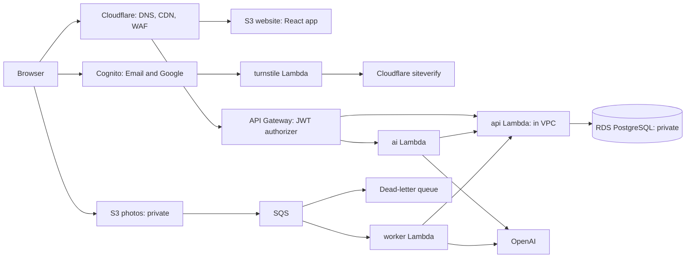
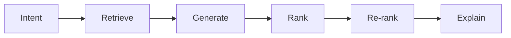
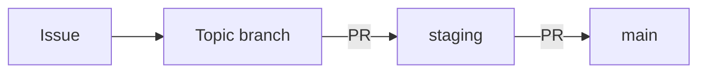

# AI Closet

### Snap your clothes. Let AI sort them. Never ask "what do I wear?" again.


[Features](#features) · [Architecture](#architecture) · [AI](#how-the-ai-works) · [Security](#security) · [Roadmap](#roadmap) · [Workflow](#workflow)

---

> [!NOTE]
> **Setup phase.** Everything below is the planned design. No app code or cloud
> resources exist yet.

## What is it?

AI Closet is a single-page app for your wardrobe. Photograph each piece, let AI tag it,
then tell the app where you are going. It builds outfits from clothes **you already own**.

It is also a cloud project: every tier is **wired by hand in the AWS Console**, with no
Amplify and no other PaaS.

## Features

| Feature | What it does | Scope |
|---|---|:-:|
| **Smart upload** | Resizes photos in the browser and strips location data | Required |
| **AI tagging** | Detects category, colors, pattern, formality, warmth and more | Required |
| **You have the last word** | Correct any tag, or add a piece with no photo | Required |
| **Outfit builder** | Matches your occasion and the weather | Required |
| **Saved outfits** | Save, reject, or mark an outfit as worn | Required |
| **Shopping picks** | Suggests pieces from a curated catalog | Bonus |
| **Virtual try-on** | AI visualization of an outfit, not a fit guarantee | Stretch |

## Architecture



### Full stack

| Tier | Choice | Job |
|---|---|---|
| Frontend | React + Vite on S3 | Static single-page app |
| Edge | Cloudflare | DNS, CDN, HTTPS, WAF, Turnstile |
| API | API Gateway (HTTP API) | Routing, throttling, JWT checks |
| Compute | AWS Lambda (Python) | `api`, `ai`, `worker`, `turnstile` |
| Auth | Cognito | Email/password and Google OAuth |
| Database | RDS PostgreSQL + pgvector | Closet data and embeddings |
| Queue | SQS + dead-letter queue | Photo tagging and try-on jobs |
| ML API | OpenAI | Tagging, embeddings, explanations, try-on |

### Design choices

- **No NAT Gateway.** Lambdas that call OpenAI stay outside the VPC and reach the
  database through the `api` Lambda.
- **Slow work is queued.** API Gateway times out at about 30 seconds, so tagging and
  try-on run as background jobs.
- **Safe to retry.** A duplicate upload event never creates a second garment.

## How the AI works



| Step | What happens | Powered by |
|---|---|---|
| **Intent** | Turns "dinner, a bit chilly" into constraints | OpenAI, or buttons as a fallback |
| **Retrieve** | Finds matching pieces in your closet | SQL + pgvector |
| **Generate** | Combines them into full outfits | Our templates |
| **Rank** | Scores color, formality, weather and style | Our rules |
| **Re-rank** | Adds variety and avoids recent repeats | Our rules |
| **Explain** | Says why the outfit works | OpenAI |

> [!IMPORTANT]
> **OpenAI never picks the winner.** Our own code ranks outfits, so the same closet,
> constraints, history and versions always give the same result.

## Security

- Every user-data query is filtered by the signed-in user
- The database is not reachable from the internet
- Photos stay in a private bucket behind signed URLs
- Turnstile is checked on the server, not just in the browser
- Requests that skip Cloudflare are rejected
- Secrets stay out of the code

## Project layout

```
CloudComputing_Final/
├── docs/        architecture, API, demo script
├── cloud/       one AWS Console guide per tier, plus policies
├── backend/     ai_core/, functions/, db/, evals/, tests/
└── frontend/    React + Vite app
```

## Roadmap

1. Repo setup
2. Hello-world site on S3 + Cloudflare, network and database
3. Sign-in, API Gateway and Lambda
4. Closet, uploads and AI tagging
5. Outfit recommendations and evaluation
6. Shopping picks
7. Virtual try-on
8. Demo

## Workflow



1. Open an issue.
2. Branch from `staging` using `feat/`, `fix/`, `chore/`, `docs/` or `refactor/`.
3. Open a PR into `staging`.
4. A human promotes `staging` to `main`.

---

**Built for CS 686 Cloud Computing at the University of San Francisco**
